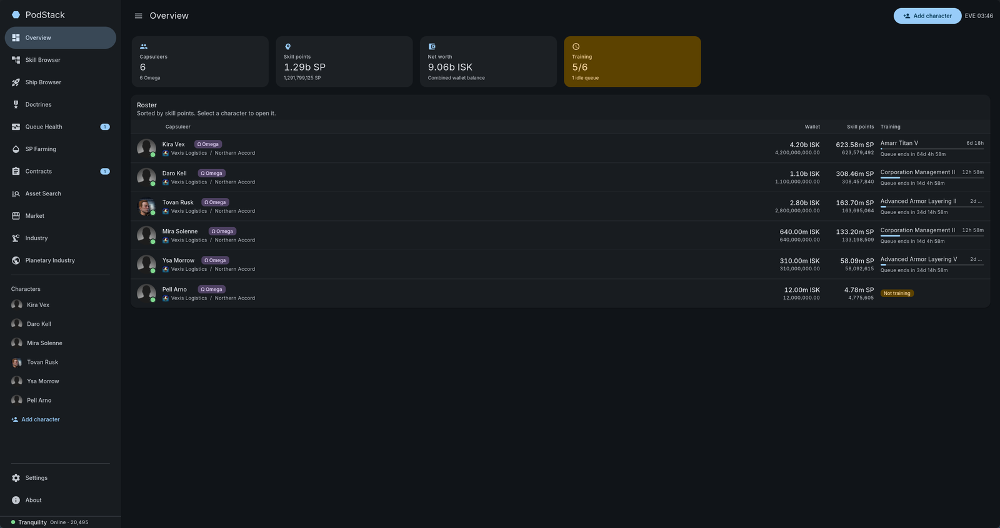
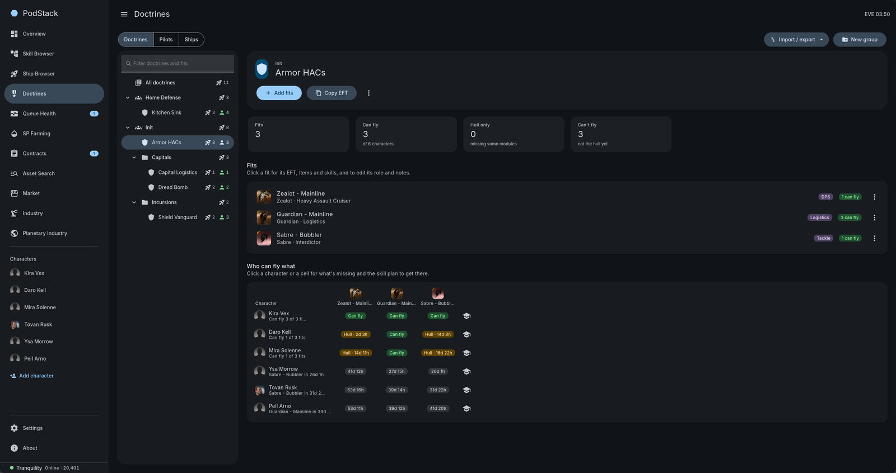
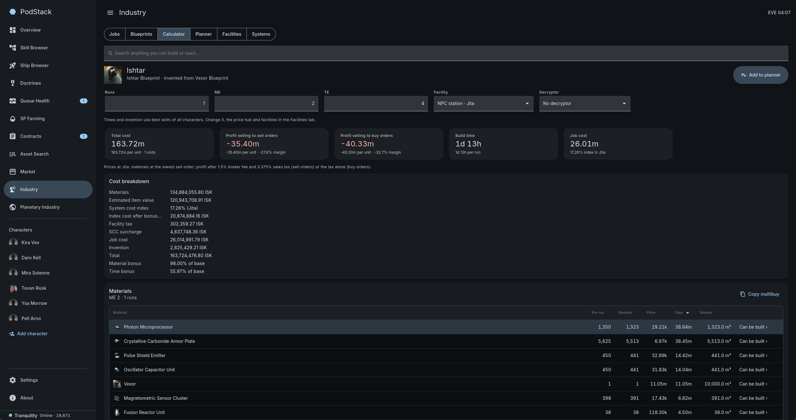
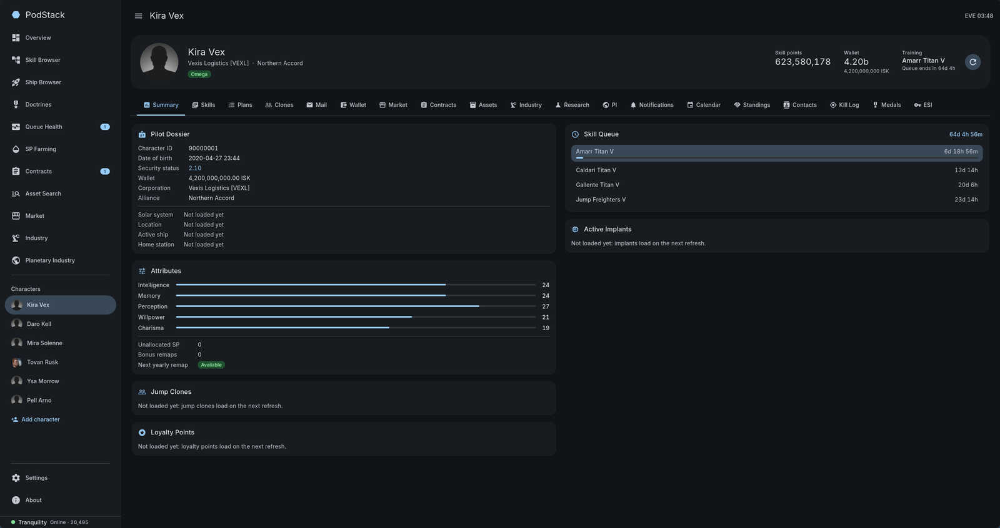
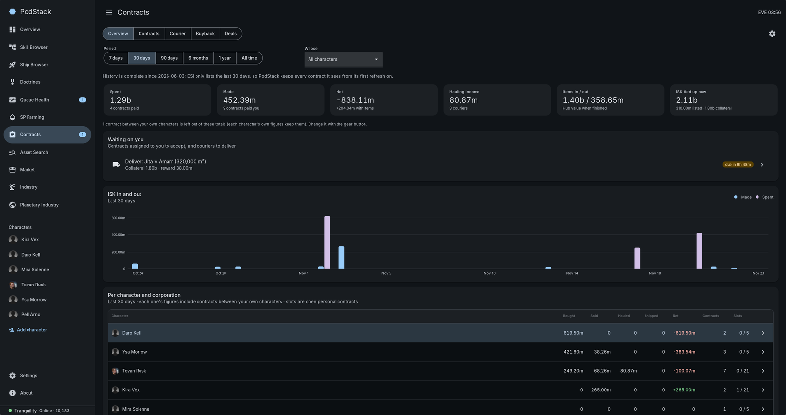
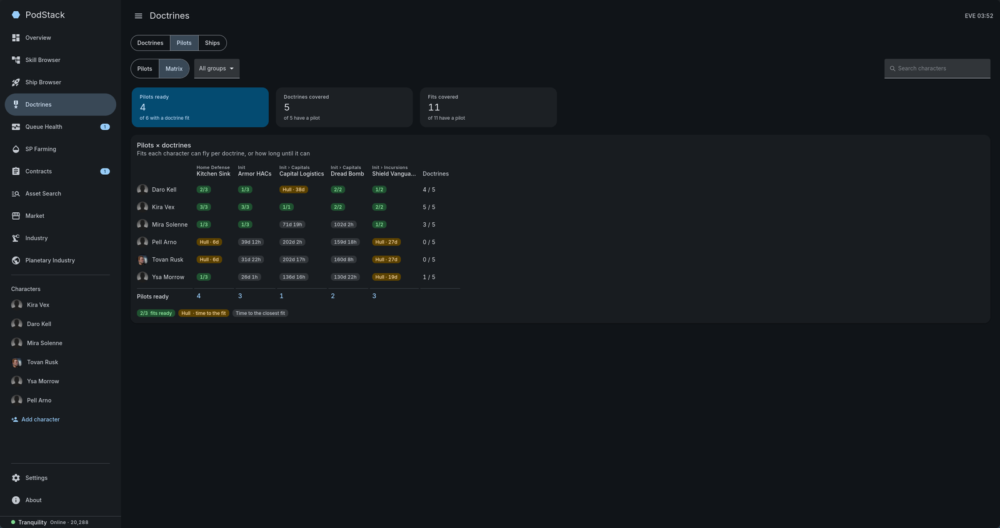
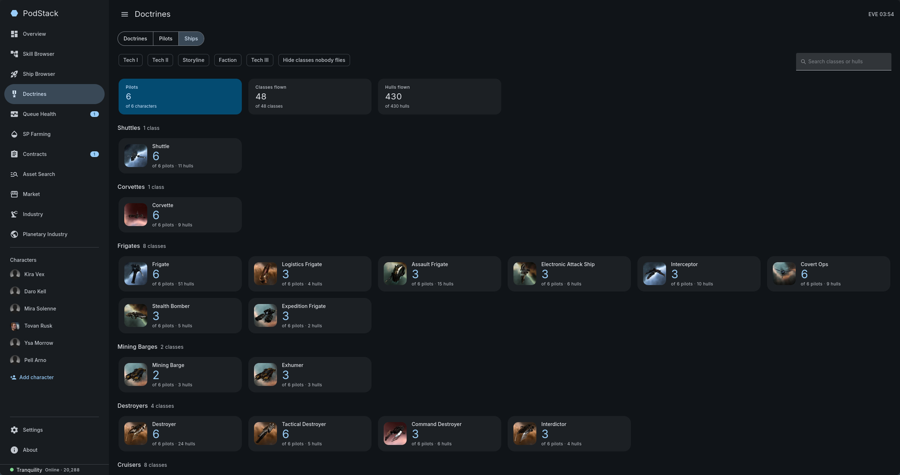
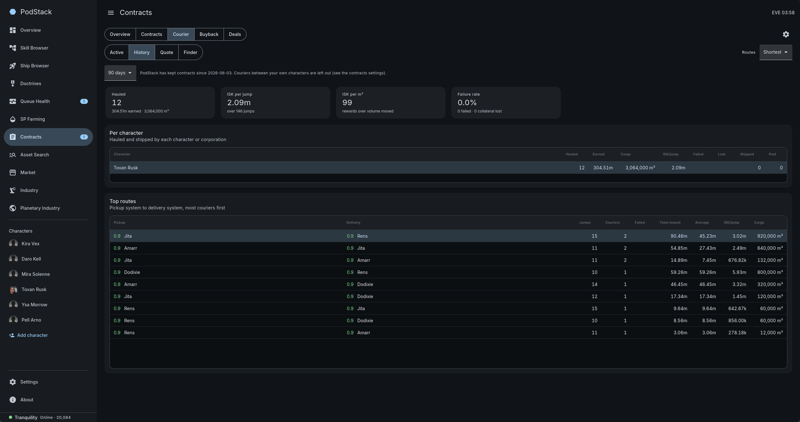
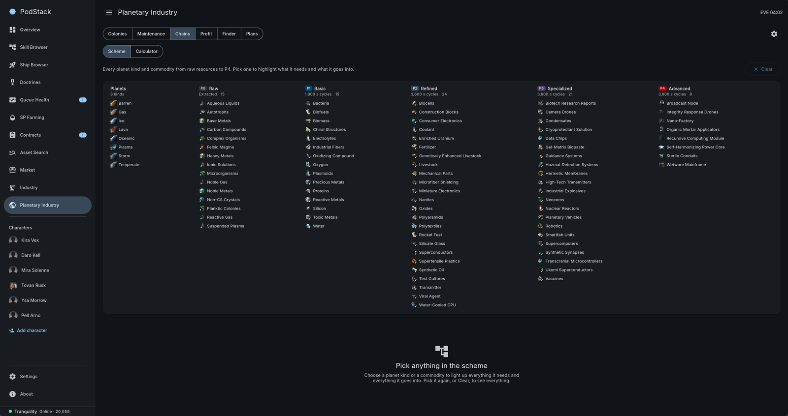
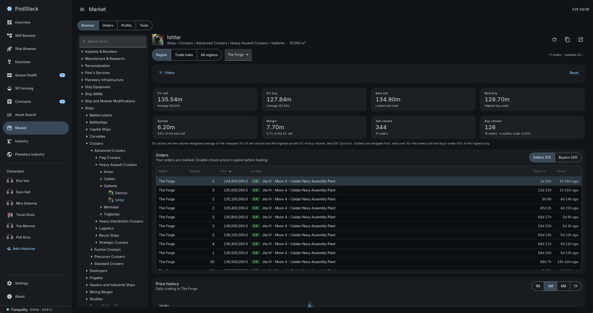

<div align="center">


# PodStack

**The EVE Online companion for capsuleers who fly more than one character.**

Skills, wallets, markets, industry, planets, contracts and doctrines for every character you own, in one fast
native desktop app.

[](LICENSE.md)
[](#install)
[](#building-from-source)
[](https://github.com/tylort69/PodStack/releases)

[Features](#features) · [Screenshots](#screenshots) · [Install](#install) · [Getting started](#getting-started) ·
[Privacy](#your-data-and-privacy) · [Building](#building-from-source) · [FAQ](#faq)



</div>

---

## Why PodStack

EVE rewards running several characters at once: a main, a hauler, a capital alt, a few skill farms. The game client
shows one at a time. PodStack shows them all, side by side, and does the arithmetic EVE players otherwise do in
spreadsheets: what each character can fly, what a doctrine still needs, what an industry job really costs at
today's cost index, what a buyback should pay, what your planets earn per hour, and what you spent on alliance
contracts over the last six months.

- **Built for many characters.** Every page works across all your characters at once, with per-character and
  combined totals. Thirty characters are as comfortable as one.
- **Native and fast.** Written in Rust with GTK4, PodStack starts quickly, stays light on memory, and never waits
  on the network to draw a page.
- **Always current game data.** Ships, blueprints, reactions, PI schematics, structure bonuses, the map and its
  stargates come from CCP's official static data export, and PodStack downloads each new release by itself. A
  balance patch never needs a PodStack update.
- **Yours, locally.** Your tokens and data never leave your computer except to talk to CCP's own servers.
- **Beautiful on your desktop.** A Material You (Material 3) design that takes its colors from your wallpaper, an
  EVE faction, or any color you choose.

## Features

### Characters and skills

- **Overview** of every character: Alpha/Omega, corporation and alliance, wallet, skill points, the skill in
  training and time left.
- **Character pages** with summary, skills, skill plans, clones and implants, mail, wallet (journal, transactions
  and balance chart), market orders, contracts, assets, industry, research agents, planets, notifications,
  calendar, standings, contacts, kill log, medals and ESI scope health.
- **Skill plans** with remaps, implants, accelerators and skillbook costs; import and export (PodStack JSON,
  EVE's skill plan text, EVEMon); a fit planner that turns any fit into a plan.
- **Skill browser** and **ship browser** with training times for any of your characters.
- **Queue health** across every account: idle queues, paused training, failing logins and ready injectors at a
  glance.
- **SP farming**: farms, injectors ready, time to the next one, and ISK per farm per month after fees, extractors
  and Omega or MCT costs.

### Doctrines

For alliance pilots juggling several fleets and several characters.

- **Groups, SIGs and doctrines.** Make a group for each alliance or community you fly with, subgroups for its SIGs
  (Capitals, Incursions, Blobs…) as deep as you like, and doctrines under any of them. Nesting is there when you
  want it, never required.
- **Fits in, fits out.** Paste fits from EVE's fitting window, Pyfa or any EFT text (several at once), EVE's XML
  export or DNA links. Copy any fit or a whole doctrine back as EFT, and share a group or your whole library with
  corp mates as one file.
- **Who can fly what.** For every doctrine, which of your characters can fly each fit, which can only sit in the
  hull, and how long until the rest can.
- **Skill plans in one click.** For any character and any fit (or a whole doctrine), copy the missing skills in
  EVE's own skill plan format, or add them to a PodStack skill plan.
- **Pilots** shows every character's flyable doctrine fits, and a characters × doctrines matrix.
- **Ships** counts your pilots per hull class ("4 dreadnought pilots, 17 battleship pilots") and drills into races
  and individual hulls, with the training time for everyone else.



### Contracts

From the occasional ship purchase to running a buyback or courier service.

- **History beyond 30 days.** ESI only lists a month of contracts; PodStack keeps every contract it sees, so "how
  much did I spend on alliance ship contracts in the last six months" has an answer.
- **Spending and income** per character and across all of them: bought, sold, hauled and shipped, by
  counterparty, by item, by availability (alliance, corporation, personal, public), by tag, over time.
- **Every contract** with filters, tags, notes and CSV export, and a detail view with the items' market value, the
  courier route and its security, and auction bids.
- **Courier**: active hauls with deadlines and collateral at risk, hauling history (ISK per jump, per m³, failure
  rate, top routes), a quote calculator for your own rate cards, and a finder for public couriers by distance,
  volume, collateral and ISK per jump.
- **Buyback**: programs with rates per item group, paste-and-appraise offers with the contract to create, an
  incoming queue that flags over-asking contracts at live prices, and the buyback's margin over time.
- **Deals**: public item exchanges and auctions in any region, ranked by discount to market.
- **Corporation contracts** too, for corporations that run the service.

### Market

- **Browser** for any item's order book and price history in any region or trade hub.
- **Orders** across all characters, with where each stands against the competition.
- **Profits**: trade profits matched from transactions, a warehouse of what's still unsold, and margins after
  broker fees and sales tax at your skills and standings.
- **Tools**: a margin calculator and an appraisal for any pasted list, hangar or fit.

### Industry

From a first frigate to alliance capital programs.

- **Jobs** and free slots across all characters.
- **Blueprints** you own, and every blueprint in the game.
- **Calculator**: materials, time and job cost for any manufacturing, reaction, invention or research job, with
  the system's cost index, structure and rig bonuses, facility tax and decryptors.
- **Planner**: build anything (a shopping list, a fit, a fleet of titans) down to raw materials, with every
  reaction, component, invention and purchase, split into jobs across your characters' slots.
- **Facilities** with your structures and rigs, and **Systems** to find the cheapest place to build.



### Planetary industry

- **Colonies**: every planet's extraction, factories, storage fill and value per hour, with expiring and stalled
  colonies flagged.
- **Maintenance**: everything to do this week across all characters, most urgent first.
- **Chains**: every commodity from planet to P4, and a calculator for any product and amount.
- **Profit** per factory hour after customs tax, a **finder** for systems by planet type, and **plans** that lay
  out a production chain across your characters.

### Everything else

- **Asset search** across all characters, with estimated values.
- **Desktop alerts** through your notification daemon: training stopped or running low, lapsed to Alpha, injector
  ready, contract completed or assigned to you, courier due soon, new mail, jump fatigue ended, industry job ready,
  PI extractor stopped, market order finished, new notifications and calendar events. Each can be turned on or
  off.
- **Tray icon** with close-to-tray, and alerts that keep running while the window is hidden.
- **Password-protected backup and restore** of your logins, characters, plans and settings in one file.

## Screenshots

| | |
|:---:|:---:|
|  |  |
| A character's summary | Contracts: spending and income |
|  |  |
| Doctrines: pilots × doctrines | Doctrines: pilots per hull class |
|  |  |
| Contracts: courier history | Planetary industry: production chains |
|  |  |
| Market browser | Industry: a Tech II build with invention |

## Install

### Arch Linux

Download the package from the [latest release](https://github.com/tylort69/PodStack/releases) and install it:

```sh
sudo pacman -U podstack-git-*.pkg.tar.zst
```

Or build the package yourself from the PKGBUILD in this repository:

```sh
git clone https://github.com/tylort69/PodStack.git
cd PodStack/packaging/arch
makepkg -si
```

Optional extras: `matugen` (colors from your wallpaper), a notification daemon such as mako, dunst or swaync
(desktop alerts), and a bar with a tray such as waybar (tray icon). Hyprland users can add the window rules in
[`packaging/hyprland/podstack.lua`](packaging/hyprland/podstack.lua).

### Other Linux distributions

PodStack runs anywhere GTK 4.20 or newer does. [Build it from source](#building-from-source) and run the binary,
or install the desktop entry in [`packaging/`](packaging) alongside it.

## Getting started

1. Open PodStack and choose **Add character**.
2. Log in with EVE Online in your browser and approve the permissions PodStack asks for.
3. Your browser then tries to open `https://localhost/callback…` and shows an error page: that's expected. Copy the
   address from the address bar and paste it into PodStack.
4. Repeat for each of your characters. PodStack starts loading their data at once and keeps it fresh in the
   background.

**Skip the copy and paste** by registering your own application at
[developers.eveonline.com](https://developers.eveonline.com) with a callback such as
`http://127.0.0.1:8765/callback` and the scopes PodStack uses, then entering its client id and callback in
**Settings → EVE login**. PodStack then catches the login by itself.

**When PodStack asks for a new permission** (for example corporation contracts, used by buyback and courier
corporations), log the character in again with **Add character**. If you use your own EVE application, enable the
new scope on it first.

## Theming

**Settings → Appearance** offers three color sources, each turned into a complete Material 3 color scheme in dark,
light or system mode, with a choice of scheme variant and contrast:

- **Wallpaper**: colors from your desktop wallpaper through [matugen](https://github.com/InioX/matugen). With
  PodStack's template in your matugen config ([`packaging/matugen`](packaging/matugen)), PodStack matches the rest
  of your desktop exactly and re-themes live when your wallpaper changes.
- **EVE factions**: Amarr, Caldari, Gallente, Minmatar, Jove, ORE, CONCORD, EDENCOM, Triglavian, Sansha's Nation,
  Guristas, Angel Cartel, Blood Raiders and Serpentis.
- **Custom**: any color you pick.

## Your data and privacy

- PodStack talks only to CCP: the EVE login servers, the ESI API and CCP's static data downloads. There is no
  PodStack server, account, analytics or telemetry.
- Login tokens are stored in `~/.local/share/podstack/auth.json`, readable only by you. Everything else lives in
  `~/.local/share/podstack` (your characters, plans, doctrines, contract history and settings) and
  `~/.cache/podstack` (prices, names and CCP's static data), and stays there.
- **Settings → Backup & restore** writes one password-protected file you can restore on another machine.
- Removing a character from PodStack revokes its login and deletes its data and skill plans. You can also revoke PodStack's access at any
  time from your EVE account's [third-party applications](https://community.eveonline.com/support/third-party-applications/)
  page.

## Building from source

You need a stable Rust toolchain and GTK 4.20 or newer (with its development files).

```sh
git clone https://github.com/tylort69/PodStack.git
cd PodStack
cargo run --release
```

| Variable | Use |
|---|---|
| `PODSTACK_DATA_DIR` | Use another data folder instead of `~/.local/share/podstack`. |
| `PODSTACK_CACHE_DIR` | Use another cache folder instead of `~/.cache/podstack`. |
| `PODSTACK_LOG` | Log level, for example `debug`. |
| `PODSTACK_OFFLINE` | Show the data on disk without refreshing any character (for the demo data). |

### Project layout

| Path | Contents |
|---|---|
| [`crates/core`](crates/core) | Everything without a user interface: EVE login, the ESI client with rate limiting, CCP's static data and its updates, and the calculations behind every page. |
| [`crates/app`](crates/app) | The GTK4 application: the window and navigation, Material 3 widgets, themes, and one module per page. |
| [`data`](data) | A bundled snapshot of CCP's static data, used until PodStack has downloaded a newer one. |
| [`packaging`](packaging) | The Arch PKGBUILD, desktop entry, matugen template and Hyprland rules. |
| [`legacy`](legacy) | The original Electron app this one grew from, kept for reference. |

### Development

```sh
cargo test                  # unit tests
cargo clippy --all-targets  # lints
```

To try PodStack without logging in, generate demo data (six characters with skills, half a year of contracts and
a doctrine library) into an empty folder and point PodStack at it:

```sh
cargo run -p podstack-core --example demo_data -- /tmp/podstack-demo/data /tmp/podstack-demo/cache
PODSTACK_OFFLINE=1 PODSTACK_DATA_DIR=/tmp/podstack-demo/data PODSTACK_CACHE_DIR=/tmp/podstack-demo/cache cargo run
```

To refresh the bundled static data from one of CCP's exports:

```sh
cargo run -p podstack-core --example convert_sde -- <unzipped static data folder>
```

[`CLAUDE.md`](CLAUDE.md) describes the architecture, data flow and UI conventions in more detail. Bug reports and
pull requests are welcome on [GitHub](https://github.com/tylort69/PodStack/issues).

## FAQ

**Is PodStack allowed by CCP?**
Yes. PodStack only reads your data through CCP's official ESI API, with the permissions you approve when you log
in. It never automates the game client.

**Does it work with Alpha characters?**
Yes. Training times account for Alpha clone training speed and skill limits, and PodStack alerts you when a
character has lapsed to Alpha.

**Why does the contract history start when I installed PodStack?**
CCP's API only lists the last 30 days of contracts. PodStack keeps everything it sees from the first refresh on,
so your history grows from then.

**A new expansion changed ships or industry. Do I need to update PodStack?**
No. PodStack checks CCP's static data releases every few hours and switches to a new one by itself. Rules that
CCP only publishes in patch notes (such as the industry tax rates) can be edited under Industry → Facilities.

**Windows or macOS?**
This version is Linux-first. The earlier Windows release of PodStack remains available on the
[releases page](https://github.com/tylort69/PodStack/releases).

## Credits

PodStack began as a fork of [1234nin4321/PodStack](https://github.com/1234nin4321/PodStack), itself descended from
Cerebral, and has since been rewritten from the ground up in Rust.

EVE Online and the EVE logo are the registered trademarks of CCP hf. All rights are reserved worldwide. All other
trademarks are the property of their respective owners. EVE Online, the EVE logo, EVE and all associated logos and
designs are the intellectual property of CCP hf. All artwork, screenshots, characters, vehicles, storylines, world
facts or other recognizable features of the intellectual property relating to these trademarks are likewise the
intellectual property of CCP hf. CCP hf. has granted permission to PodStack to use EVE Online and all associated
logos and designs for promotional and information purposes on its website but does not endorse, and is not in any
way affiliated with, PodStack. CCP is in no way responsible for the content on or functioning of this application,
nor can it be liable for any damage arising from the use of this application.

## License

PodStack is free software under the [GNU Affero General Public License v3.0](LICENSE.md). Bundled fonts: Inter
(SIL Open Font License) and Material Icons (Apache 2.0); see [`assets/fonts/LICENSES.md`](assets/fonts/LICENSES.md).
